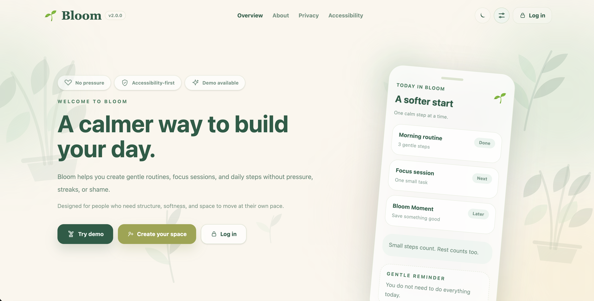
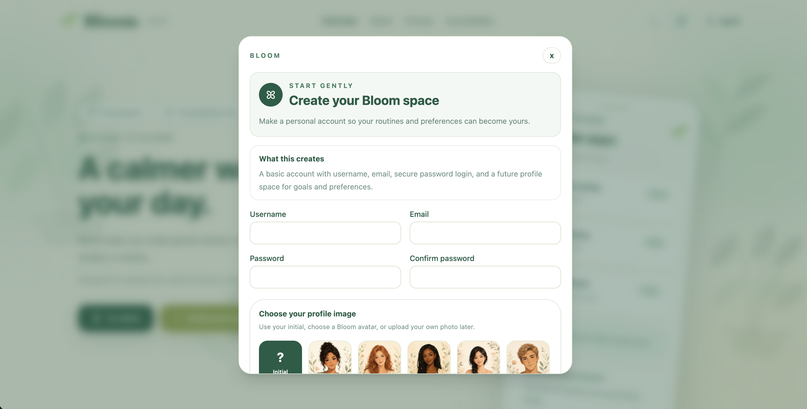
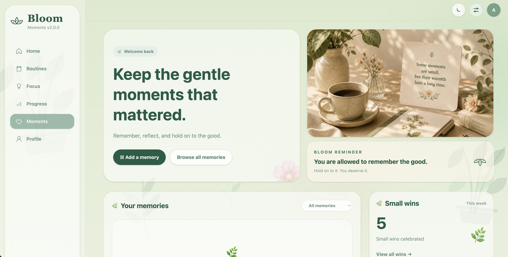
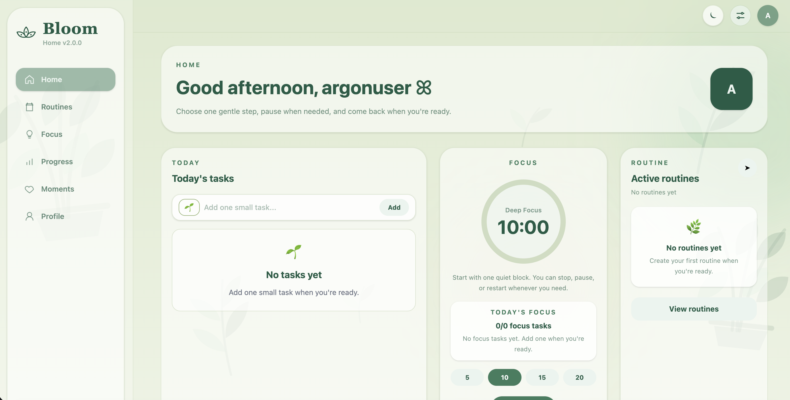
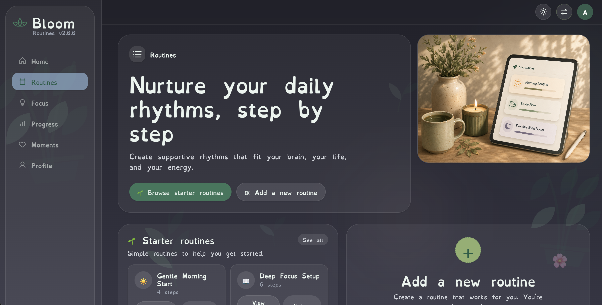
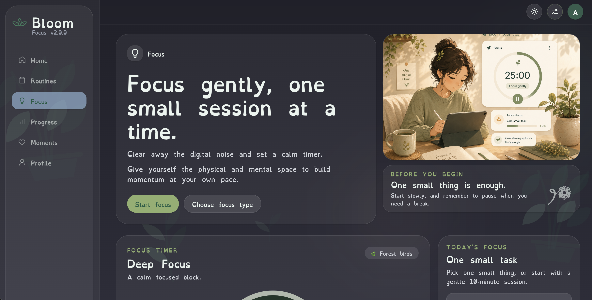

# 🌱 Bloom

**Small steps. Steady routines. Room to grow.**

A visual task planner without streaks, pressure, or the feeling of falling behind.

Bloom is an accessibility-focused visual task planner for everyday tasks, routines and focus.

Bloom Personal uses calm interfaces, gentle task sequencing, focus sessions and reflection to help users make progress without turning missed days into failure.

> **Current status:** v2.2.2 → v3 production live beta

## Live Demo

[Experience Bloom](https://bloom-app-three-xi.vercel.app/)

## Features

- Visual task and routine planning
- Calm task sequencing
- Focus sessions
- Progress, reflection and Moments
- Demo mode with preloaded routines
- Account creation and login
- Persistent authenticated user data
- Light and dark themes
- Text-size controls
- OpenDyslexic font option
- Reduced-motion setting
- Responsive desktop and mobile layouts
- Public About, Privacy and Accessibility pages

## Screenshots

<table>
  <tr>
    <td>
      
      <br/>
      <strong>Public overview</strong>
    </td>
    <td>
      
      <br/>
      <strong>Create account</strong>
    </td>
  </tr>
  <tr>
    <td>
      
      <br/>
      <strong>Moments</strong>
    </td>
    <td>
      
      <br/>
      <strong>Home</strong>
    </td>
  </tr>
  <tr>
    <td>
      
      <br/>
      <strong>Routines — dark mode</strong>
    </td>
    <td>
      
      <br/>
      <strong>Focus — dark mode</strong>
    </td>
  </tr>
</table>

## Tech Stack

| Area | Technologies |
| --- | --- |
| Frontend | React, JavaScript, Tailwind CSS, Vite |
| Backend | Python, FastAPI |
| Authentication | JWT |
| Deployment | Vercel |
| Configuration | Environment-based configuration and CORS |

## Run Locally

```bash
git clone https://github.com/Iris408/bloom-app.git
cd bloom-app
npm install
npm run dev
```

### Build Check

```bash
npm run build
```

Backend setup and environment configuration are documented in `/docs`.

## Documentation

Additional project documentation is available in `/docs`, including:

- Setup Guide
- Product Roadmap
- Accessibility Notes
- Demo Mode
- Project Details
- Beta Notes
- Security & Config
- AI-Assisted Workflow

## Development Status

Bloom v2.2.2 is currently running as a live production beta while development moves toward the Bloom v3 beta.


## Author

Built by [Iris408](https://github.com/Iris408).